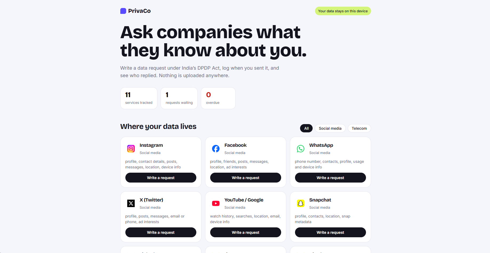

# PrivaCo

**Track your data requests under India's DPDP Act. Everything stays on your device.**

PrivaCo helps ordinary people ask companies what data they hold, correct it, or delete it, and keeps track of who replied. It runs entirely in your browser: no account, no server, no uploads.

**Live demo:** [add your link here once published]

## Why I built this

India's Digital Personal Data Protection Act, 2023 gives people rights to access, correct, and erase their personal data. The rules are new, and there is no simple consumer tool for using those rights or keeping track of the responses. Writing a proper request, finding the right contact, and remembering to follow up is a lot of friction, so most people never do it.

PrivaCo is my attempt to reduce that friction, starting with social media and telecom services.

## What it does

- Lists services that hold your data (Instagram, WhatsApp, Jio, Airtel and others), and lets you add your own.
- Generates a request letter for **access**, **correction**, or **erasure**, based on the DPDP Act.
- Lets you log when you sent a request and tracks a 90-day follow-up countdown, flagging overdue ones.
- Records each outcome (waiting, replied, completed, refused) with notes.
- Exports and imports your data as a backup file.

## Privacy by design

- All data is stored in your browser's local storage. Nothing is sent to a server.
- Your name and account details are used only to fill in the letter on screen and are never saved.
- Company logos are fetched from an external icon service. This can be switched off in the footer for fully offline use.

## How to use it

1. Open the live demo, or download `index.html` and open it in a browser.
2. Pick a service and choose "Write a request".
3. Enter your name and account detail, then copy the letter.
4. Find the company's Grievance Officer contact in its privacy policy and send the request yourself.
5. Press "I sent this, track it" and update the status when they reply.

## Limitations (please read)

- **Not legal advice.** The letters are templates, and I'm not a lawyer. Section references should be checked against the official text of the Act.
- **No automatic discovery.** PrivaCo cannot find where your data is held. You decide which services to track.
- **It does not send anything.** You send each request yourself.
- **The 90-day countdown is a personal reminder, not a legal deadline.** Some DPDP obligations only take full effect in 2027, so companies may not yet have a formal process.
- Telecom companies must retain certain records, such as KYC, so erasure requests to them may be partly refused.
- Data lives in one browser on one device. Use Export backup to keep a copy.
- PrivaCo is not affiliated with the companies whose names or logos appear. Logos belong to their owners.

## Built with

Plain HTML, CSS, and JavaScript in a single file, with no frameworks or dependencies.

## How it was built

I designed the idea, chose the problem, and made the product decisions. I used an AI assistant (Claude) to write code, and I'm learning to read and change it as I go. The `prototype/` folder holds my first Python versions, which I used to work out the logic before building the web version.

## Roadmap

- [ ] Verified grievance contacts for each service, based on my own testing
- [ ] Write-up of what happens when real requests are sent
- [ ] AI policy reader: paste a privacy policy and get red flags in plain language
- [ ] Local logo files instead of an external icon service
- [ ] Hindi and other Indian language support
- [ ] Browser extension

## Contributing

Spotted a wrong contact, a missing service, or a confusing sentence? Open an issue or send a pull request.

## Disclaimer

PrivaCo provides templates and tracking tools only. It is not a law firm and does not give legal advice.
